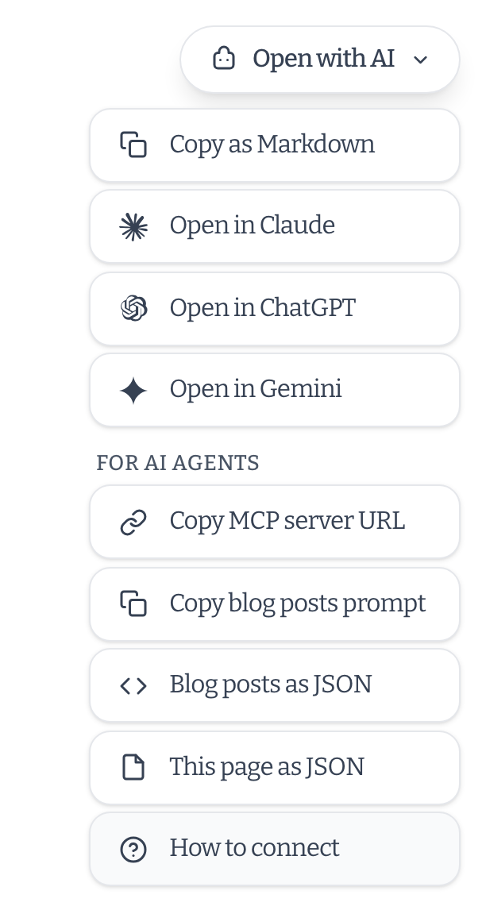

I have always been a fan of automation and the new generation of AI tools opens up levels of informed automation that were never possible before. One area I have been increasingly automating is my content pipeline. This has included creating first drafts of Q&A style articles from podcast interviews and video transcripts. A task that I could do "fully human" but I am not sure it's the best use of my time. Another has been using Claude and the wonderful [Typefully](https://typefully.com/) to promote some of my work.

But one issue I have hit time and again is chat tool and agent sandboxing around URLs. I am probably missing something, but all my automated tasks involving accessing links, including my own site, constantly time out if I am not available to approve accessing the link. So for this, and potential future reasons I expanded the AI tool support on this site to include API, MCP, and WebMCP support. I am yet to figure out how I will integrate it yet, but you are also welcome to.

If you find it useful, then [please consider finding a way to support my work](/support).

## An "Open with AI" menu on every article

In the bottom right of articles, books, stories, and other long-form pages, there's an "Open with AI" button. It can copy the page as Markdown (with the frontmatter), or open it in Claude, ChatGPT, or Gemini with a prompt to read and summarise it.

The menu now has a "For AI agents" section too. It can copy the MCP server URL (more on that next), copy a prompt that tells an assistant which tools to use for the section you're reading, and link to the same page or section as JSON.



## A remote MCP server

The biggest addition is a [Model Context Protocol](https://modelcontextprotocol.io) server at `https://chrischinchilla.com/mcp`. If your assistant supports remote MCP servers, you can add it and ask questions about my work, and it can search and read the site rather than relying on whatever it remembers.

With Claude Code, for example:

```sh
claude mcp add --transport http chrischinchilla https://chrischinchilla.com/mcp
```

It exposes five read-only tools:

- `list_content_types` describes everything on the site, with counts.
- `list_content` browses a listing, for one content type or all of them, with filters for category, tag, and date.
- `search_content` does fuzzy search across titles, summaries, and tags.
- `get_content` returns one entry in full, as Markdown.
- `list_tags` lists the tags in use.

There's no sign-in, because everything it serves is already public. The [AI page](/ai) has setup instructions for other clients.

## WebMCP

[WebMCP](https://webmachinelearning.github.io/webmcp/) is a proposed web standard that lets a page offer tools to the browser's own AI agent, rather than the agent having to click around and scrape. Every page here registers the same tools as the MCP server, plus one for reading any page on the site, like my CV.

It's an early draft and browser support is limited, so most people won't see any difference yet. The code feature-detects the API and does nothing if it isn't there. I've also had to handle the fact that the API has moved around in recent drafts.

## One content model

Rather than building the MCP server and the WebMCP tools separately, both read the same static JSON API, generated at build time from the site's content. It lists every content type (blog posts, books, stories, newsletters, music, games, events, and more) and has a full version of each entry, including the Markdown. You can use it directly: start at [`/api/content/index.json`](/api/content/index.json).

The tool definitions are shared too, so a change to one shows up in both. The MCP server itself is a small Netlify Function that fetches the static JSON, so it never touches the content files directly and can only serve what was published.

## The older, simpler components

Two other things were already available and fit the same use case. [`/llms.txt`](/llms.txt) is an index of the whole site in a format aimed at language models, and [`/llms-full.txt`](/llms-full.txt) contains the full text. Articles also carry structured data and the usual RSS feed, which helps with traditional search as well.

## Caveats

This is all read-only and none of it is a way to get paid or credited for training use. It only makes the site easier to use accurately. There's also nothing yet to rate-limit the MCP server, so I may need to add that if it gets heavy use.